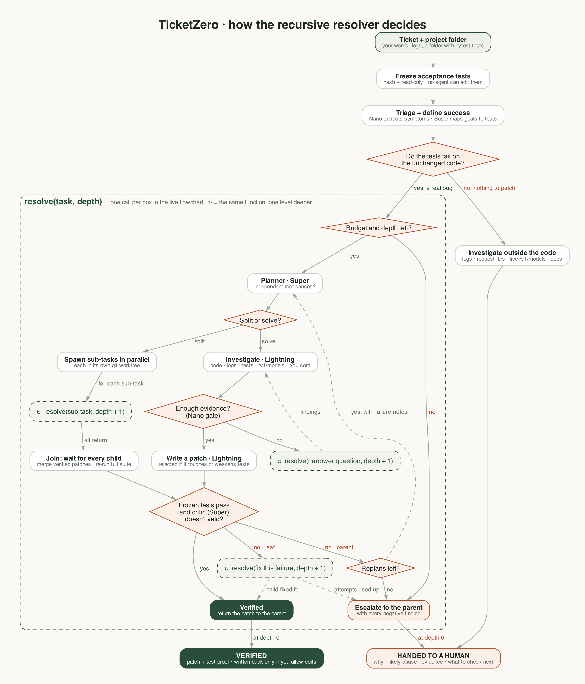

# TicketZero

**A team of Nemotron agents that resolves support tickets on its own, and refuses to fake a fix.**

Point TicketZero at a broken project folder and describe the problem. Agents on Crusoe Managed Inference plan the
work, split it into sub-problems, investigate in parallel, write patches in isolated sandboxes, and prove each fix
against tests that no agent can edit. When a verified fix isn't possible, for example because the failure came
from the provider's side, it stops and hands a human the evidence and the next steps instead of guessing.

Built for the Crusoe × Cerebral Valley *Recursive Agents* hackathon.

<p align="center"></p>

## How it works

Every box in the execution tree is one call of a single recursive function, `resolve(task, depth)`. Parents
split work into children, wait for **all** of them, merge their patches, and verify again. The flowchart above
shows every decision ([source](docs/flowchart.dot)).

- **One recursive resolver.** Depth is just an argument. Budgets (LLM calls, tokens, wall time, depth) are checked
  at the entry of every call, so a run always ends.
- **Isolated parallel work.** Each node gets its own git worktree. Children only return patches; only the parent
  merges them, then re-verifies the original goal.
- **Frozen acceptance tests.** Tests are hashed and made read-only before any agent runs. Patches that touch tests,
  skip them, or weaken them are rejected.
- **Independent verifier.** Tests run in a clean subprocess, then a different model reviews the diff and can veto a
  pass that is hardcoded or off-target. It can never turn a failure into a pass.
- **Honest escalation.** If the failure doesn't reproduce (all tests pass on the unchanged code), nothing is patched.
  Escalated runs show why, the likely cause, the evidence (logs, request IDs, sources) and what to check next.
- **Shared memory.** Every node records what worked and what didn't, so siblings and replans don't repeat failed
  ideas.
- **Research.** Investigators read the code, logs and tests, query Crusoe's live `/v1/models`, and search official
  docs through You.com, citing what they used.

### Model routing (Nemotron on Crusoe)

| Role | Model |
|---|---|
| Planner, replanning, independent verifier | Nemotron 3 Super 120B |
| Investigator, fixer | Nemotron 3.5 Lightning 30B |
| Triage, evidence gate | Nemotron 3 Nano 30B |

Model IDs are resolved live from `/v1/models` at startup, with fallbacks when a model isn't available on your account.

## Quick start

You need Python 3.11+, Node 20.19+ (or 22.12+), git, a Crusoe API key and, optionally, a You.com API key.

```bash
cp .env.example .env            # add your keys (use single quotes: Crusoe keys can contain $)

# Backend
python3 -m venv .venv
.venv/bin/pip install fastapi "uvicorn[standard]" pydantic openai requests pytest
.venv/bin/uvicorn ticketzero.api:app --host 127.0.0.1 --port 8000

# Frontend, in a second terminal
cd frontend && npm ci && npm run dev    # open the address Vite prints
```

Then pick an example on the start page and press **Start investigating**. The flowchart grows as agents split the
work. Select any box to see that agent's task, evidence, patch and test results.

## Demos

Every demo is a small real Python project with real failing tests, written for this hackathon.

| Demo | What it shows | Expected |
|---|---|---|
| **Chat endpoint failing** | Three independent bugs, split into three parallel fixes, merged and re-verified | Verified |
| **Tool calls break after the first call** | A first patch fails verification; the failure becomes a deeper task | Verified |
| **Voice audio returns 400** | No documented request format exists, so it stops instead of guessing | Escalated |
| **Benchmark T01–T06, T08, T09, T11** | One bug each in a small weather app: retired model, wrong base URL, ignored tool calls, unparsed tool arguments, truncated JSON, oversized `max_tokens`, wrong API key variable, misread stream, a tool loop that's too short | Verified |
| **Benchmark T07, T10, T14** | Provider outages (503, intermittent 500, 504): the code is fine, so nothing should be patched | Escalated |

The benchmark tickets are under "Benchmark tickets" on the start page. Their originals, with the answer key and a
scoring script, are in [`demo_examples/`](demo_examples/TICKETS_README.md). You can also pick one of those folders
with **Choose folder** and describe the problem in your own words.

## Using your own project

1. **Choose folder** opens the macOS folder picker (or type a path). The page shows how many files and tests the
   agents will see.
2. The folder needs **pytest tests that fail now and should pass once fixed**. They become the frozen acceptance
   tests. Python projects only, for now.
3. Describe the problem, optionally with logs and the expected behavior, and start.

Your folder is never edited during a run: agents work on a sandbox copy. Secrets (`.env`, keys), `.git`,
dependencies and caches are never copied, so they never reach a model. If you click **Allow file edits** before
starting, a verified fix is written back at the end, but only to files you haven't changed since the run began. If
the project has a `.venv` with pytest, its tests run with that interpreter.

## Configuration

Settings come from `.env` in the project root; variables exported in your shell take precedence.

| Variable | Default | Purpose |
|---|---|---|
| `CRUSOE_API_KEY` | required | All model calls |
| `YDC_API_KEY` | optional | Web research; without it, research tools report "unavailable" |
| `TICKETZERO_HOME` | `./ticketzero_data` | Database, run sandboxes, escalation bundles |
| `TICKETZERO_RPM_PER_MODEL` | `25` | Starting request rate per model; lowered automatically after a 429 |
| `TICKETZERO_MAX_INFLIGHT_PER_MODEL` | `2` | Concurrent requests per model |
| `TICKETZERO_LIVE_TESTS` | `1` | `0` skips tests marked `live` (they call Crusoe) |
| `BACKEND_URL` | `http://127.0.0.1:8000` | Where the frontend dev server sends `/api` |

Default run budget: 120 LLM calls, 1.5M tokens, 15 minutes, depth 3, three children in parallel.

## Tests

No keys or network needed: a scripted stand-in replaces the model calls, while sandboxes, patching, pytest,
the database and the API all run for real.

```bash
.venv/bin/python -m pytest              # backend: full runs, safety checks, escalation, folders
cd frontend && npm test                 # flowchart layout, escaping, timeline mapping
```

## Project layout

```
TicketZero/
├── ticketzero/                   Backend (FastAPI)
│   ├── resolver.py               The recursive resolver: split, join, merge, replan, escalate
│   ├── agents.py                 Planner, investigator tool loop, evidence gate, fixer
│   ├── verify.py                 Frozen-test runner and independent verifier
│   ├── sandbox.py                One git worktree per agent, frozen test files
│   ├── patches.py                Patch validation and application
│   ├── llm.py                    Crusoe client: budgets, adaptive rate limiting, retries
│   ├── models.py                 Nemotron model routing from the live /v1/models
│   ├── tools.py                  Agent tools: files, logs, tests, models, web
│   ├── research.py               You.com search, cached
│   ├── workspace.py              Reads a project folder, writes a verified fix back
│   ├── reports.py                Reports and the human handoff
│   ├── api.py                    HTTP API
│   ├── runner.py                 Run lifecycle
│   ├── store.py                  SQLite store and shared memory
│   └── scenario_data/            Built-in demos: scenario.json, logs.txt, repo/
├── frontend/                     Web app, built into a single index.html
│   ├── ticketzero-ui.js          Live run view, flowchart, evidence, handoff
│   ├── ticketzero-model.js       Flowchart layout and timeline (tested in qa/)
│   ├── ticketzero-folder-ui.js   Folder picker and file browser
│   └── ticketzero-api.js         Backend client
├── demo_examples/                Benchmark tickets, answer key, build_catalog.py, score.py
├── docs/                         Flowchart image and its Graphviz source
└── tests/                        Offline backend tests
```

## Limitations

- Python projects with pytest tests only; the folder picker uses macOS (on other systems, type the path).
- Projects are capped at 3,000 files / 30 MB, and the fixer's prompt includes about 60 KB of source.
- Live runs depend on Crusoe capacity: heavy rate limiting slows runs down, and reasoning models take tens of seconds
  per planning step, so a demo takes a few minutes.
- Tests that call real APIs can occasionally fail on their own; a verified result always reflects a real test run.
